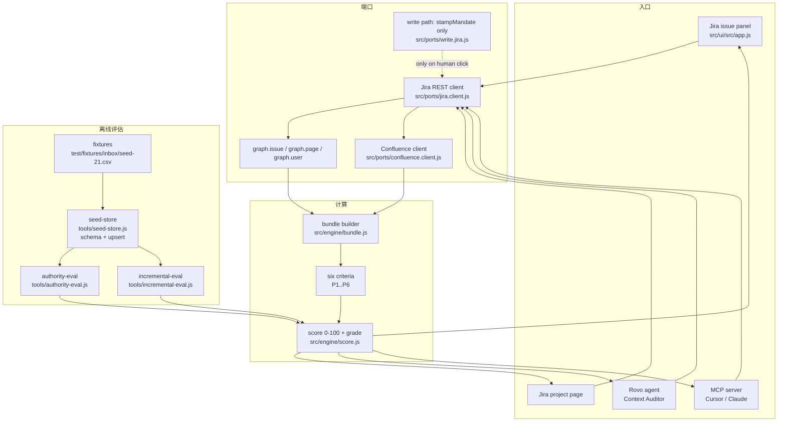

# Mandate 架构图

> 这张图是 **Forge 运行路径 + 离线评估路径**，不是营销架构。每个节点都能在代码里找到对应文件。

## 读路径

1. 入口只读：`read:jira-work`、`read:graph:issue:jira`、`read:graph:page:confluence`、`read:graph:user:atlassian`。
2. 每个 issue 装配成 `bundle`：issue 字段 + 决策页正文（ADF 转文本）+ goal + reviewer 关系。
3. 六条判据逐条返回三值 `present / absent / unknown`；只有 `absent` 才能触发 finding。
4. `score.js` 把 finding 加权到 0–100，并给出 `grade` 与 `ceiling`。

## 写路径

- 唯一写动作 `stampMandate`：人工点击后，把当前分数与证据链接写回 issue 的一条 comment。
- `write:jira-work` 默认注释，不默认开启；没有自动改字段、没有批量写入。
- MCP 与 Rovo 共用同一套 action，不另设写入口。

## 离线评估路径

- `tools/seed-store.js`：校验表结构（缺列即拒绝）、按 `issue_key` upsert、按键查询。
- `tools/authority-eval.js`：21 条带时间戳样本，全查基线 + bootstrap 区间 + 时间留出 + P2 反事实。
- `tools/incremental-eval.js`：以 `updated` 为水位，只算新增/变更，验证第二次 0 重算。
- 这两条路径只用于证明管道自洽与增量正确，不进入 Forge 运行时。
